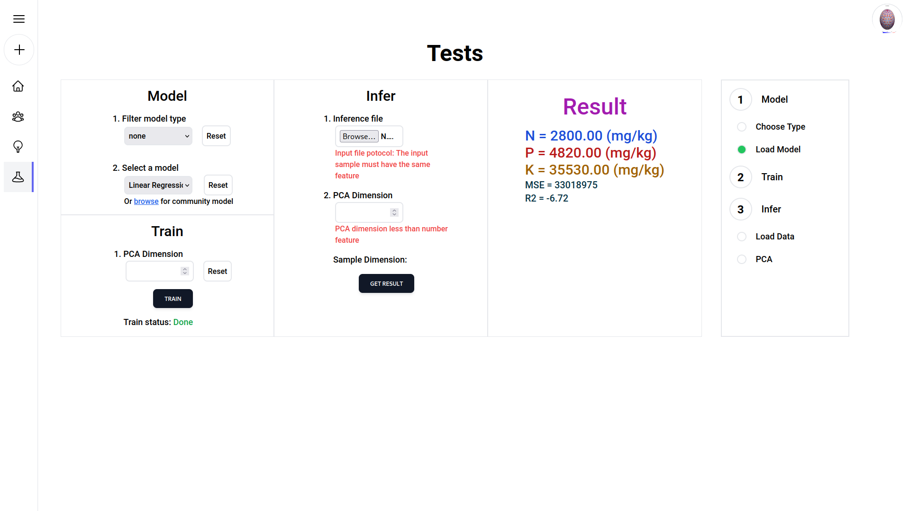
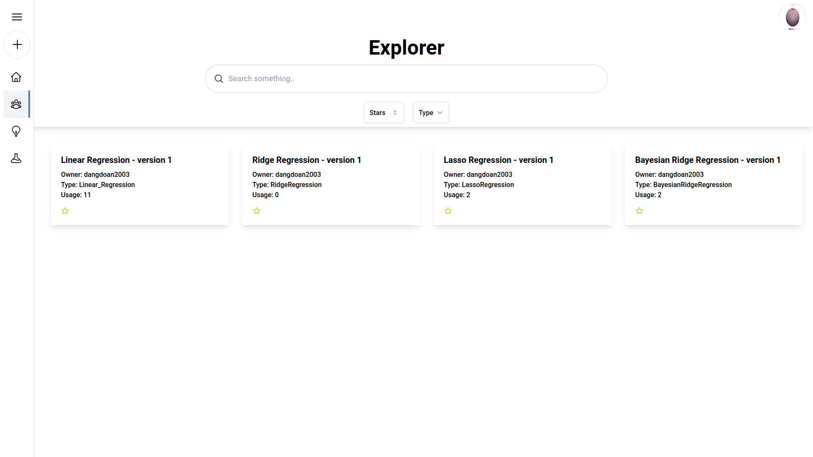
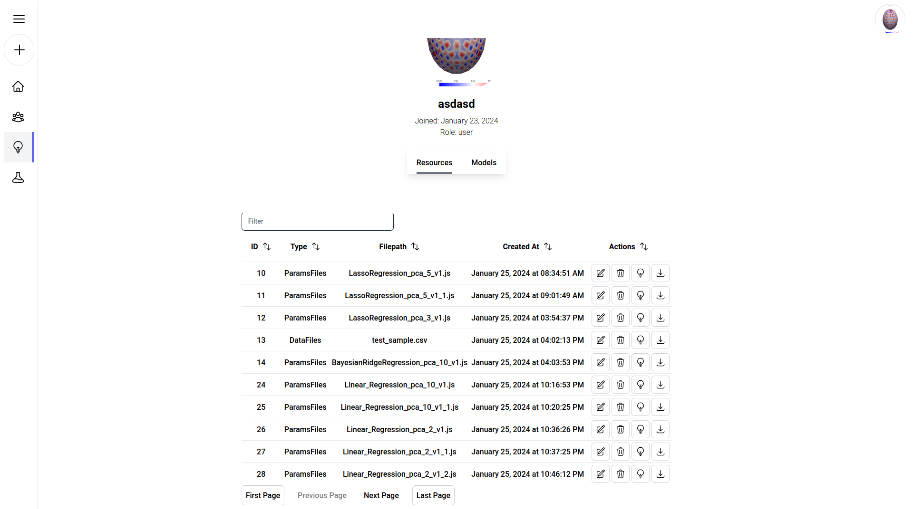
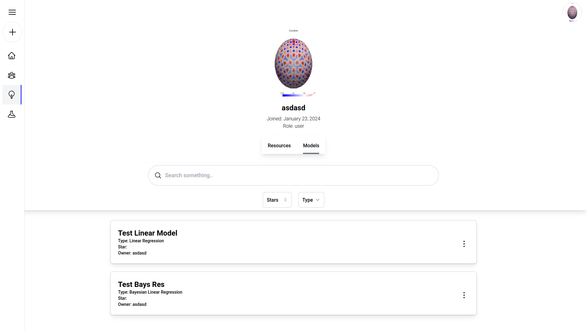
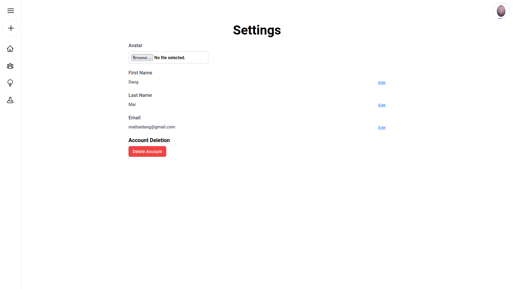
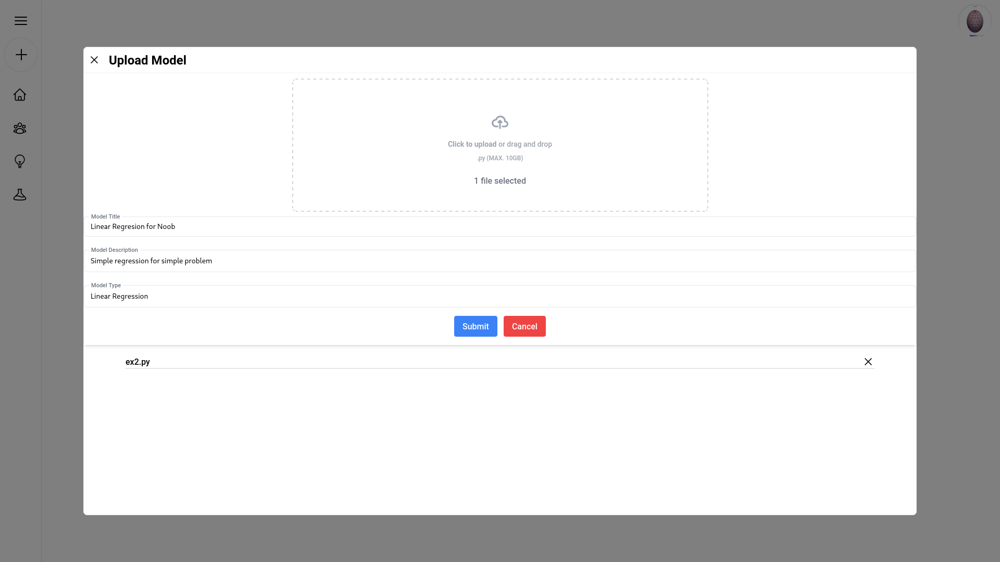
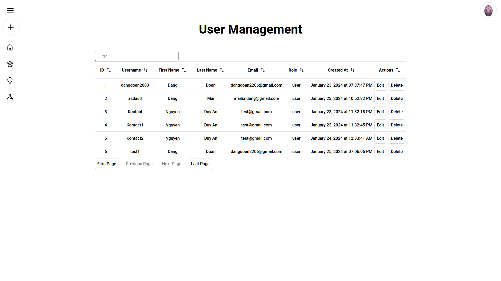
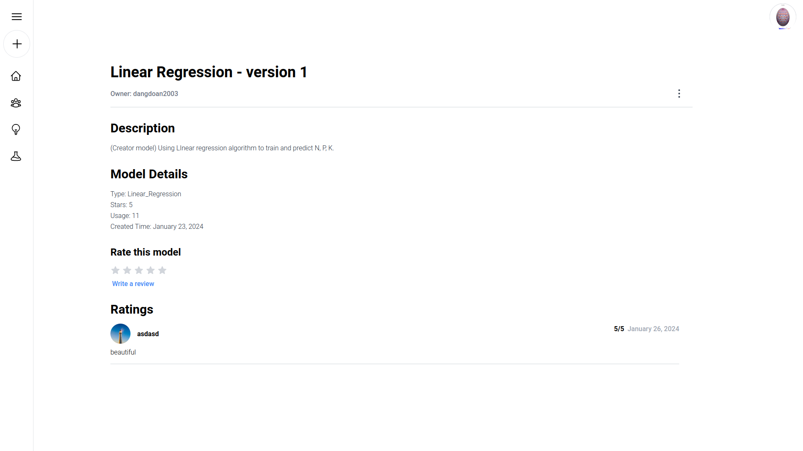

# Web Application

## Description

- This is a web application that allows users to create, read, update, and delete (CRUD) data from a database. 
- The user can also upload files such as models (.py), resources (.csv, .txt, etc) for model training and prediction, download the trained model and the prediction results.

## Frameworks and Libraries

- React + Tailwind CSS + Vite

```bash
npm install
```

- Quick Run

```bash
npm run dev
```

## Backend

This UI targets **version 2.0** of the [dashboard](https://github.com/dangdd2003/dashboard) backend
(see its `API.md`):

| Service | Default URL | Env variable |
|---|---|---|
| `dashboard-security` (issues the JWT, `POST /jwt`) | `http://localhost:8080/` | `VITE_SECURITY_API_URL` |
| `dashboard-user` (REST API, `Authorization: Bearer <jwt>`) | `http://localhost:8081/` | `VITE_USER_API_URL` |

Copy `.env.example` to `.env.local` to point the UI elsewhere (keep the trailing slash).
The dev server runs on port `3000`, which is the backend's default `CORS_ORIGINS`
(`http://localhost:3000`); add your origin to `CORS_ORIGINS` when serving the UI from anywhere else.

Notes on the 2.0 API:

- After sign-in the UI loads `GET /users/profile` to get the user id and role (the JWT is encrypted).
  Tokens expire after 1 hour; on a `401` the UI signs out.
- The caller is always taken from the JWT, so the UI no longer sends `user_id` on create/update calls.
- Model files must have a base name matching `[A-Za-z0-9][A-Za-z0-9_-]{0,127}` (e.g. `linear_regression.pkl`),
  and model/resource types must match `[A-Za-z0-9_-]{1,64}` (e.g. `MPAP`).
- Avatars must be PNG or JPEG, at most 5 MiB.

## Screenshots








